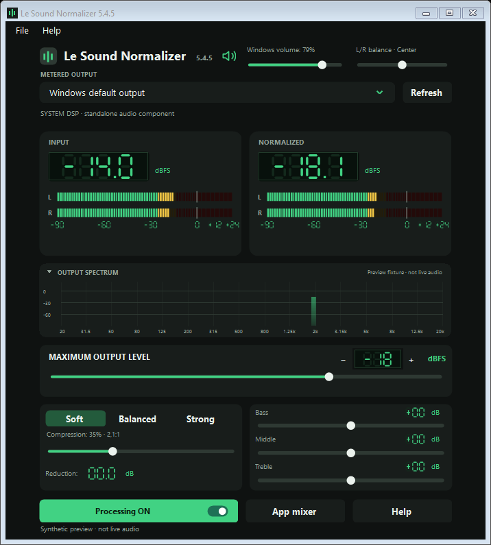

# Le Sound Normalizer — Windows Audio Control

The featured image is a version 5.4.5 development preview with synthetic meter and spectrum signals, not a live playback measurement.

A quiet dialogue scene followed by a loud effect can make a comfortable movie volume difficult to maintain. Le Sound Normalizer brings a configurable digital output ceiling, compression presets and tone controls into a Windows audio workspace.

The interface lets the user inspect before-and-after levels, adjust the listening setup and review supported input devices. It controls digital sample levels; it is not a calibrated measurement or guarantee of physical sound pressure.

## Tech stack

| Layer | Technologies |
|---|---|
| Controller | C#, Windows Forms, .NET Framework |
| Native audio | C++, Windows audio processing |
| Compatibility | WASAPI, optional VB-CABLE |

## Make sudden level changes easier to manage

Choose a maximum output level in dBFS and use Gentle, Movie or Night compression as a starting point. Adjustable compression strength lets the user shape the response for the material being played.

The ceiling and compression serve related purposes but are different controls. Review the before-and-after readings while adjusting the setup instead of assuming that one preset fits every recording.

## Shape the listening presentation

Bass, middle and treble controls support tone adjustments, while left/right balance helps adapt the stereo presentation. Before-and-after LED meters, digital readings and a collapsible spectrum make the effect easier to inspect.

Appearance, meter and window preferences let the controller fit a brief adjustment or a longer listening session. The current settings remain close to the information used to review them.

## Choose the supported audio path

System DSP uses the application's own Windows audio component and does not require Equalizer APO, Peace or a virtual cable. Installing that component requires Windows administrator approval.

The optional Compatibility engine uses WASAPI with an existing VB-CABLE installation. Automatic selection can fall back to that route when its prerequisites are available.

## Understand where processing applies

Native processing supports mono, stereo, 5.1 and 7.1 PCM. Encoded movie audio must first be decoded by the player; HDMI or S/PDIF passthrough and modes that bypass Windows effects cannot be assumed to receive the limit.

Check active processor telemetry for the selected output before relying on its setting. The product's scope depends on the actual playback path, not just the presence of a volume control on screen.

## Inspect recording inputs without disabling them

Version 5.4 lists Windows recording endpoints such as microphones, line-in, stereo mix and virtual inputs. Available inputs have independent live level meters, while unavailable devices retain their status. Paging and refresh support reviewing a larger device list.

Listen-to-playback choices apply on Save. They do not disable recording devices or change recording mute, volume or default routes. The [all-input settings image](images/all-inputs-settings-preview.png) is an isolated synthetic fixture, not the user's device inventory.

## Keep balance and diagnostics understandable

Balance adjusts the opposite side while processing is enabled and preserves the intended mono, centre and LFE behaviour. Application, native-component and crash logs provide separate places to investigate an interruption; logs do not record audio.

The [USB input settings preview](images/usb-input-settings-preview.png) also uses an isolated fixture. Controller and processing behaviour have automated coverage, while live compatibility remains limited to the configurations actually tested.

Version 5.4.1 simplifies the interface: purpose-focused About; Soft, Balanced and Strong compression presets; Original and Processed meters; fewer technical footnotes. Existing audio behavior and saved settings are preserved.

## Current availability

Le Sound Normalizer is a development build, not a broadly certified public release. The repository presents the product and its preview material; no public binary download is currently published here.

Version-specific tests and private engineering material provide the appropriate detail for installation and compatibility work. A native processing lookahead value should not be read as a measurement of total playback latency.

---

Private code: [le-sound-normalizer](https://github.com/logicencoder/le-sound-normalizer)

**[Logic Encoder](https://logicencoder.com)** · [GitHub](https://github.com/logicencoder) · [Contact](https://logicencoder.com/contact/)

Version 5.4.2 reduces About to one sentence and adds a selected-output icon beside the version: green speaker for non-Bluetooth output, blue Bluetooth for Bluetooth, neutral when unavailable. Connecting a device alone does not change the icon unless the output route follows it. The current HDMI route was verified live; Bluetooth transitions were checked with isolated fixtures, not physical pairing.

Version 5.4.3 adopts the name **Le Sound Normalizer** across the application, installer and repositories. Existing settings and audio behavior are preserved. Older linked input screenshots are historical fixtures and may show the former name.

Version 5.4.4 refreshes the output badge from Windows device notifications, adds endpoint-ancestry Bluetooth evidence when topology is unavailable, and records readable route changes. Notification registration and reacquisition were checked with live HDMI reads plus injected signals; physical Bluetooth hotplug is awaiting user testing. To follow Bluetooth automatically, choose Windows default in the app and route Windows playback to the Bluetooth device.

Version 5.4.5 uses the exact name **Le Sound Normalizer** and meter labels **Input / Normalized**, with saved settings and audio behavior preserved. Bluetooth output detection concerns Windows-connected endpoints; headphones connected to a TV are downstream of HDMI and are not identified through Windows audio metadata.
