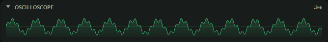
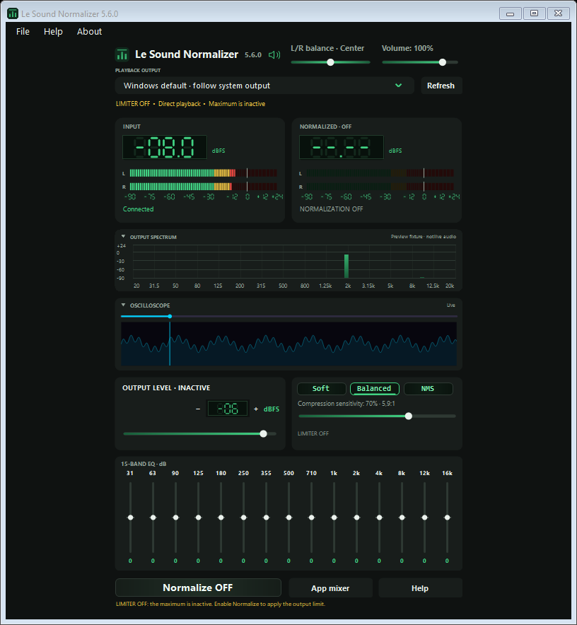
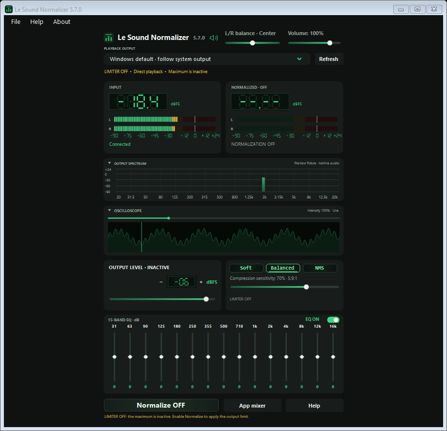
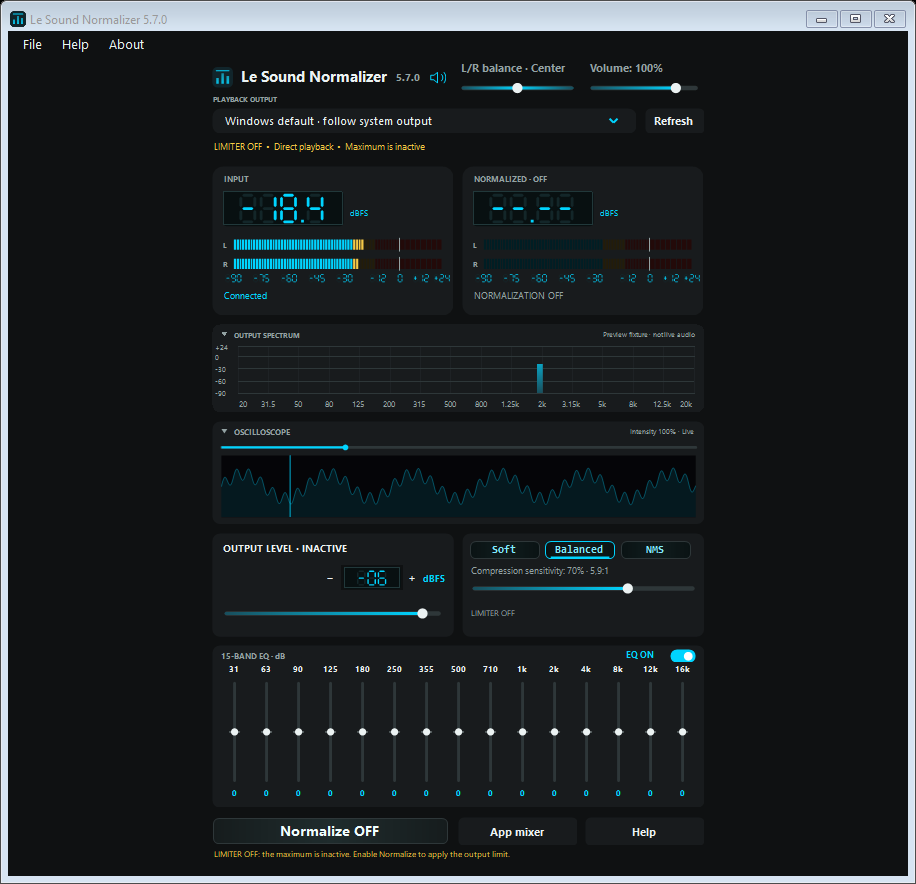
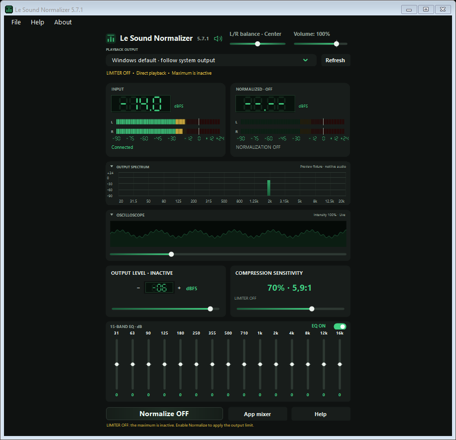
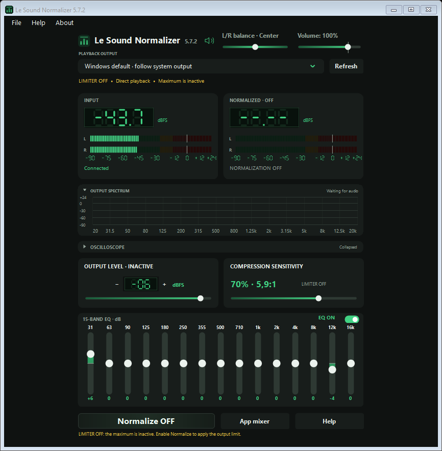
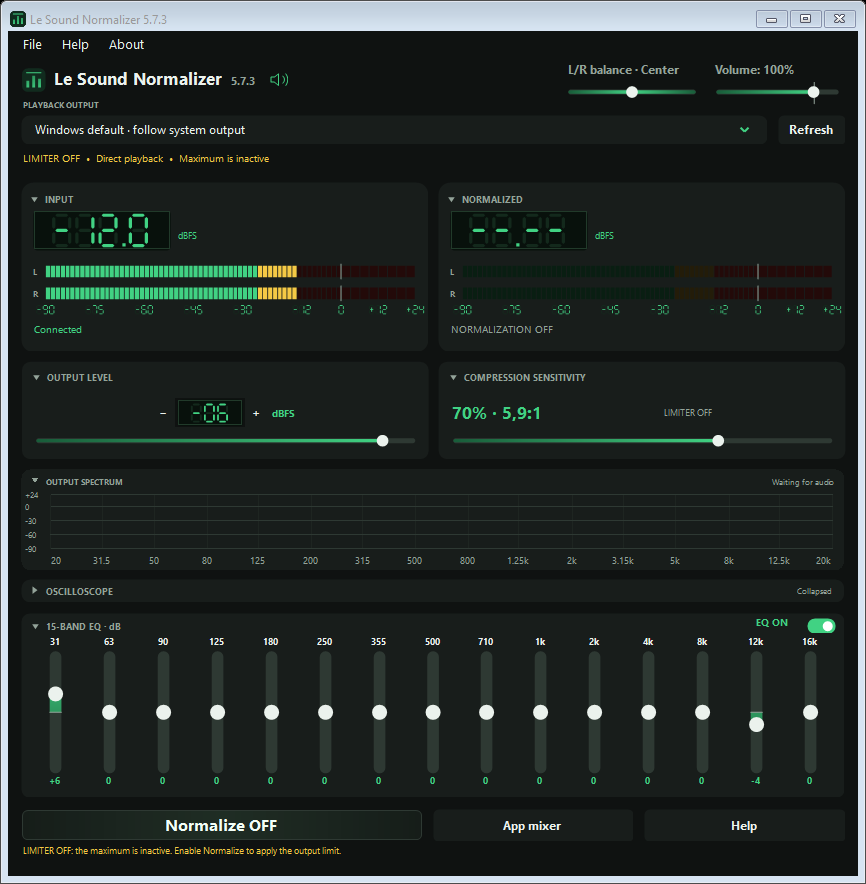
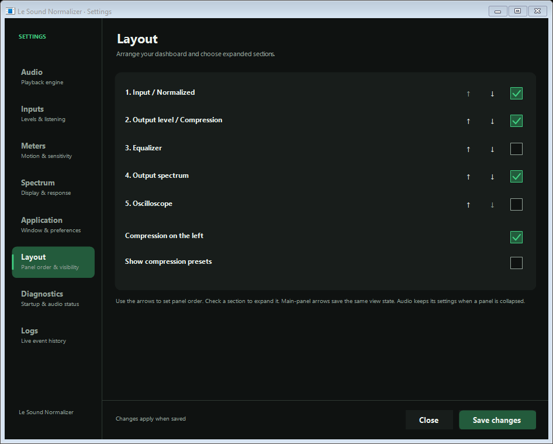
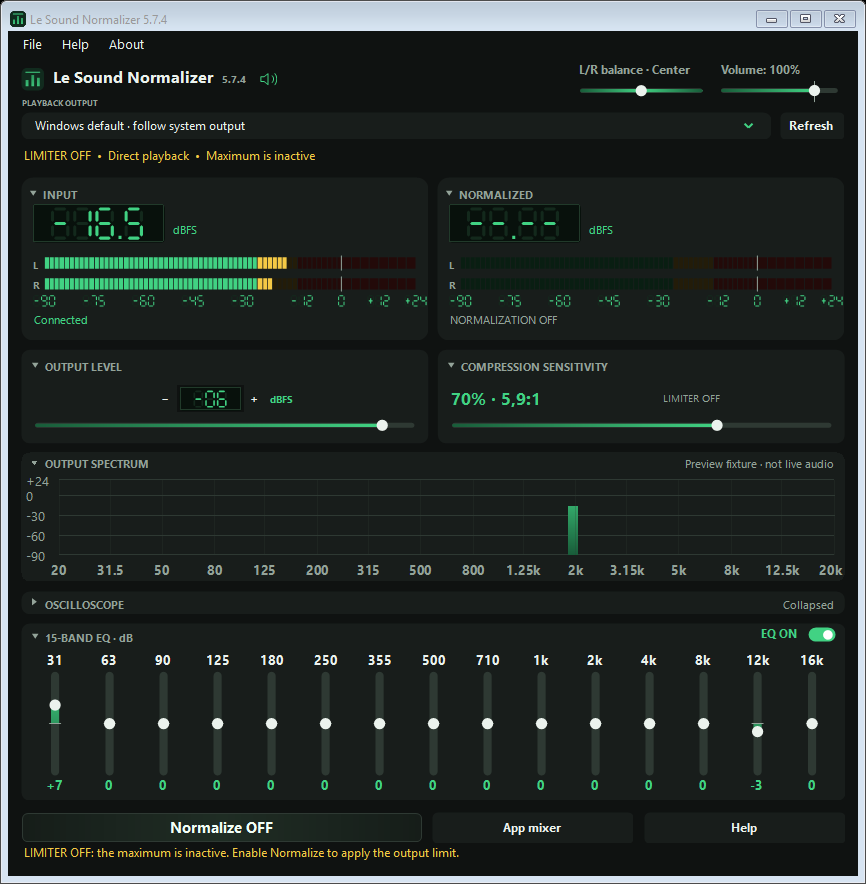
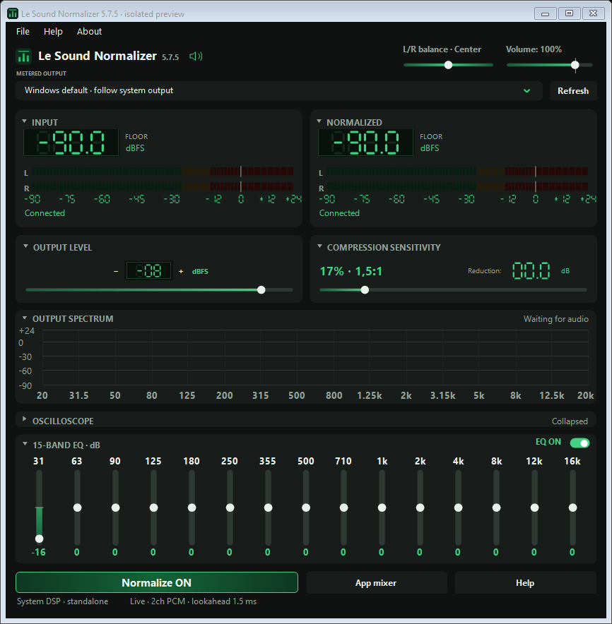

# Le Sound Normalizer

This version 5.5.0 preview uses synthetic signals, not a live playback measurement.

Normalizes loud scenes for more comfortable listening. Set an output ceiling, then adjust compression sensitivity to reduce the difference between quiet dialogue and loud effects.

- **Soft 23%**, **Balanced 42%**, **NMS 66%** compression starting points, plus an adjustable sensitivity slider.
- **Output level** sets the digital peak ceiling. **Volume** controls everyday listening volume.
- Bass, middle and treble controls, left/right balance, green digital meters and a collapsible frequency spectrum.
- Save and load your own sound presets. Settings remember your preferences and window layout.
- A speaker button mutes or unmutes the selected Windows output only when clicked.
- Recording-input meters and explicit Enable/Disable listening actions, applied on Save.
- Short Help, purpose-focused About and local application/native/crash diagnostics.

## Audio paths

System DSP uses the application's own Windows audio component. It does not require Equalizer APO, Peace or a virtual cable. Setup requires administrator approval once; normal controller use does not. Compatibility is an optional alternative using WASAPI and an existing VB-CABLE installation.

Native processing supports mono, stereo, 5.1 and 7.1 PCM. The player must decode compressed audio to PCM. Encoded HDMI/S/PDIF passthrough and paths bypassing Windows audio effects cannot be assumed to receive the ceiling. Digital dBFS readings are not physical sound-pressure measurements. Spectrum bars show individual frequency components; LED meters show the full-signal peak, so their values differ.

## Availability and verification

This is a development build with automated DSP/controller/package checks and limited host verification, not certification across all Windows systems or playback modes. The clean shareable distribution is one setup EXE with the controller, audio component, runtime libraries and license embedded inside. No adjacent DLLs, icons or development files are needed. A new PC needs setup once to register the system audio component. No public binary download is published in this repository.

The controller is built with C# and Windows Forms; its audio component is C++. Technical source and detailed versioned verification are maintained in the private repository.

[Private source](https://github.com/logicencoder/le-sound-normalizer) · [Logic Encoder](https://logicencoder.com)

Version 5.4.13 fixes meter connection status while muted: connected outputs retain MUTED even when audio blocks stop arriving, while readings clear to the floor.

Version 5.4.14 improves action contrast, enlarges Normalize, unifies application/installer/window icons and delivers the shareable package as a single setup EXE. Existing audio settings are preserved.

## New in 5.5.0

Choose a simple tone panel or a ten-band vertical EQ in Settings > Audio: 31, 63, 125, 250, 500 Hz, 1, 2, 4, 8 and 16 kHz. Each band supports +/-18 dB, and the two views keep their values. A collapsible oscilloscope below the spectrum displays the actual waveform using the same capture source.

The Volume control supports a small preamp boost up to 125% before the limiter while Normalize is ON. L/R balance now sits beside it on the left and snaps to the center. Rounded Normalize ON/OFF controls, silent Help, clear Saved feedback, a single engine chooser, classic option checkboxes and a populated Diagnostics page improve everyday use.

Version 5.5.0 passed 326 native processing scenarios plus controller, UI and standalone installer checks. It was also activated on the existing host: the exact native module was confirmed loaded by Windows Audio and a zero-only playback probe confirmed fresh processing telemetry. The installer contains all application payloads in one file.

## New in 5.5.1

The oscilloscope now uses a compact filled live waveform strip inspired by LE Karaoke Studio AFX, with the application's green theme. Adjust its display sensitivity from 30% to 300% in Settings > Spectrum; audio volume is unaffected. The full current sample window replaces the former triggered, gridded view. The panel retains its collapse arrow and shares capture with the spectrum.

## New in 5.6.0

Output level and compression now sit side by side. Reverse their order in Settings > Application > Compression on the left. EQ has a separate full-width row and expands to fifteen bands while preserving the original frequency gains. The waveform uses the supplied AFX-style cyan filled trace on a near-black background with an inspection cursor; it does not seek playback. Existing tone controls and display sensitivity remain available.

The exact native module passed 417 isolated APO scenarios and was confirmed loaded on the existing host. A silent zero-only stream confirmed fresh fifteen-band processing telemetry after the approved Windows Audio reload. Saved audio values and mute restrictions were preserved. This update does not claim new clean-machine or protected-media certification.

## New in 5.6.1

Adjust Wave intensity directly with the slider above the waveform: 30–3000%, without changing audio volume. Its percentage is visible and saved automatically. Double-click the track or press Home to return to 100%. The same value is available in Settings > Spectrum. This was verified on the installed application during real playback, including the larger live waveform and persisted intensity; the native audio module is unchanged.

## New in 5.6.2

A small EQ ON/OFF switch in the EQ header bypasses only equalization. Normalization and its output limit remain active. Saved frequency values are retained and restored when EQ is enabled again; the switch state is also saved in preferences and sound presets. Both simple and fifteen-band EQ support it. Live installed verification confirmed OFF without disabling Normalize and ON restoring the original values.

## New in 5.7.0

Choose Green or Cyan in Settings > Application > Color palette. Controls, displays, spectrum, waveform and runtime icons follow the selection; System/Light/Dark remains independent. Green now includes a green waveform. Yellow/red warning levels retain their meaning.

Settings > Audio includes Restart audio, with administrator confirmation only when clicked. The app itself continues to run normally. The action restarts Windows Audio only, refuses running dependent services and preserves mute/reduced-volume restrictions. Main-panel Refresh continues to rescan devices. The restart coordinator and cancellation paths were tested with injected services; an actual host service restart was not performed during this update.

## New in 5.7.1

The waveform cursor is removed and its intensity slider sits underneath, using the same palette-aware gradient as other controls. Volume marks 100% before its extra preamp range; EQ tracks are thicker. Output level and Compression sensitivity share aligned titles, middle values and lower sliders. Soft/Balanced/NMS are hidden by default and can be enabled in Settings > Application > Show compression presets. Saved panel order, audio values and display intensity are preserved.

## New in 5.7.2

Compression percentage/ratio and Reduction share one compact row. EQ tracks are thicker by default; choose 4–16 px in Settings > Audio > EQ track thickness. The 100% Volume tick extends above and below the thumb at exactly 100%, making the extra preamp range easier to identify. Existing audio values and panel preferences are preserved.

## New in 5.7.3

Output level and Compression sensitivity sit directly beneath the LED meters by default. Settings > Layout lets you reorder the meter row, tuning row, spectrum, oscilloscope and EQ; choose expanded sections, swap the tuning sides and show optional compression presets. Main-panel disclosure arrows remember their state without disabling processing. Both simple and 15-band EQ can collapse.

The dashboard uses the available window width. Additional height goes to an expanded visual panel while disclosure preserves control and font scale. Volume above 100% is preamp gain before the final limiter: 125% adds approximately 1.94 dB to a quiet signal, while Output level remains the ceiling.

## New in 5.7.4

Larger frequency labels and EQ gain values are the default. Settings > Text size adjusts spectrum labels, equalizer labels and supporting text independently. Spectrum keeps room for its larger labels without overlap. Panel order, disclosure state and audio settings are retained.

Preamp gain is visible in diagnostics and above 100% in the status line. At 125%, the boost is approximately 1.94 dB before compression and the limiter; Output level remains the ceiling.

## New in 5.7.5

The engine and live audio details now share one bottom row. The top DSP line is removed. Adjusting EQ keeps runtime text steady instead of briefly showing settings-sent messages; important errors remain visible and parameter details are still recorded in Logs.

